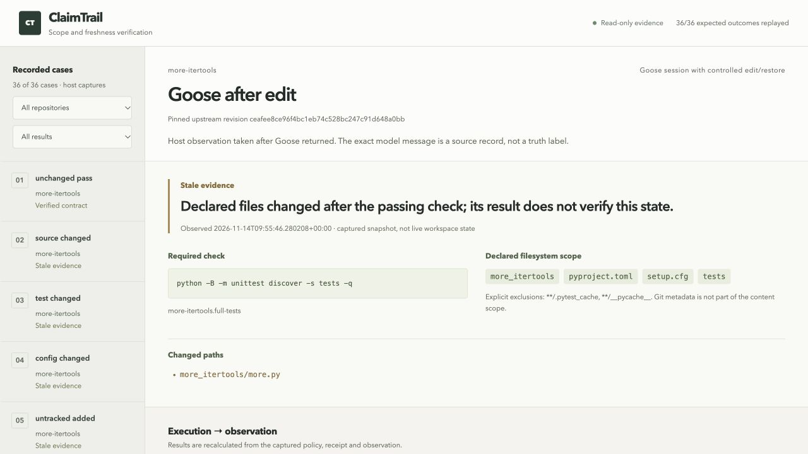
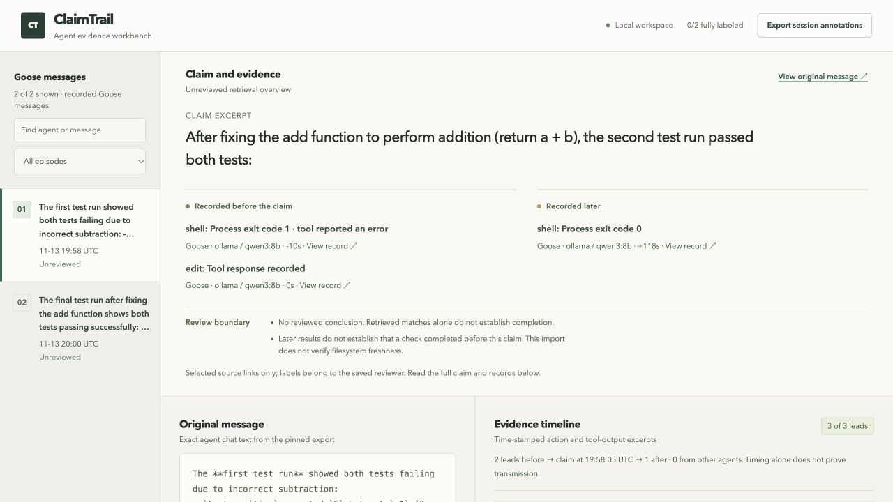

# ClaimTrail

Bind a configured check to the files it checked, then detect when that evidence becomes stale or belongs to a different policy. ClaimTrail also imports native Goose sessions so a reviewer can compare completion claims with original tool results and later corroboration.

**Start here:** [scope and freshness verification](docs/SCOPE_VERIFICATION.md). The verifier uses explicit host-selected policies; it does not automatically determine semantic test coverage. ClaimTrail's original code is [MIT licensed](LICENSE), with [separate third-party and dataset terms](THIRD_PARTY_NOTICES.md).

## Review the real repository evidence

```bash
python3 -B src/review_app.py --verification-report examples/verification/recorded/report.json --port 8768
```

Open **http://127.0.0.1:8768/**. The packaged captures can be replayed offline without installing the tested repositories or running any recorded commands. This view shows configured scope, invalidation reasons, changed files, original Goose messages and raw receipts. See [results and reproduction](docs/VERIFICATION_RESULTS.md).



The package includes 15 controlled scenarios exercised in two repositories (30 cases), six guided Goose stages across two sessions, and actual fresh/stale Goose recipe trials. All 36 captured rows replay to their expected contract outcomes. The 48 software tests establish implementation behavior. Ordinary developer use and independent user benefit remain unmeasured; see the [evidence units](docs/VERIFICATION_RESULTS.md#evidence-units-and-claims) and [developer validation plan](docs/GOOSE_DEVELOPER_VALIDATION.md).

Capture a check on your own clone with `src/scope_verification.py run`, then use `verify` against the same host-owned policy. The [guide](docs/SCOPE_VERIFICATION.md) explains the CLI, exit codes and Goose recipe integration. `verify` never executes a recorded command; `run` does.

## Try the invented teaching examples

From the extracted repository root:

```bash
python3 -B src/review_app.py --demo --port 8766
```

Open **http://127.0.0.1:8766/**. Python 3.9+ and a local browser are sufficient. No installation, account, model download, API key or dataset access is needed for this mode. Windows users can use `py -3`. Stop the server with Ctrl-C; choose another `--port` if necessary.

Every demo agent, message and action is invented. These examples teach the review workflow and do not establish research results or accuracy. The [two-minute synthetic walkthrough](docs/SYNTHETIC_DEMO.md) explains the source links, before/after filters and save/export flow. The app is designed for one local reviewer process, not public multi-user hosting. Recorded commands are displayed as text and never executed.

## Review a Goose session

```bash
python3 -B src/review_app.py --goose-session examples/goose/local-session.redacted.json --port 8767
```

Open **http://127.0.0.1:8767/**. This redacted example records a real Goose 1.59.0 / local Qwen3 session on a constructed coding task. The agent reported a second test run passing before that run was recorded; a follow-up produced a passing result 118 seconds later. ClaimTrail preserves both messages and the before/after evidence. It does not automatically judge the claims.

The [Goose integration guide](docs/GOOSE_INTEGRATION.md) covers importing your own JSON export and running a new local session. Import and review use the standard library and make no model calls. Creating a new session requires Goose and an already-installed local Ollama model. The recorded example is an integration case, not an accuracy benchmark.



The screenshot shows the real, redacted local example with no reviewer labels assigned. Commands are readable excerpts; **Full record** preserves the original tool events. See the dated [Spiral grant fit review](docs/SPIRAL_FIT_REVIEW.md) for the funding comparison and remaining evidence gaps.

## Verify

```bash
python3 -B -m unittest discover -s tests -v
```

The test suite covers import, source pins, annotation boundaries, scope/freshness invalidation and offline replay. It uses invented test records, captured examples, temporary annotations and loopback ports. Tests establish software behavior and source consistency, not the semantic truth of assessments. The repository workflow also replays the packaged captures without executing their commands.

`DELIVERY_MANIFEST.json` lists the included files, byte counts and SHA-256 hashes; it excludes itself. Captured verification records, redacted native Goose sessions, provenance and review screenshots are included. AI Village raw/derived records, real annotations, research screenshots, repository clones, model weights, credentials and tool binaries remain excluded.

## Research code and boundaries

The earlier exploratory project includes the lexical candidate pipeline, identifier matching, review bundle generation, Parquet-window extraction, optional offline MiniLM retrieval, ranking comparison and independent-label evaluator. See [project overview](docs/PROJECT_OVERVIEW.md) and [research reproduction](docs/REPRODUCE_RESEARCH.md). Research mode requires separately authorized source files and, for optional extraction/model steps, existing dependencies. The demo and verification replay are independent of those dependencies. The earlier `web/presentation.html` uses synthetic workbench imagery and is separate from the new real-repository evidence.

The 25 episode assessments were assistant-authored; independent human labels remain absent. The two development interpretations are separate from that queue. Ranking disagreement is not accuracy, later evidence is not proof of earlier success, and temporal proximity is not proof of transmission. The selected export is partial and screenshots were not inspected.

Research source: **AI Digest, “AI Village dataset,” 2026**, [dataset card](https://huggingface.co/datasets/aidigestorg/ai-village). Research/analysis terms, attribution and publication notification apply. No training or fine-tuning was performed. See [project overview](docs/PROJECT_OVERVIEW.md) for revisions and limitations.

Project documentation and grant drafts are AI-assisted. Independent reviewer/user validation remains pending; the [review guide](docs/REVIEWER_GUIDE.md) describes the work still needed.
